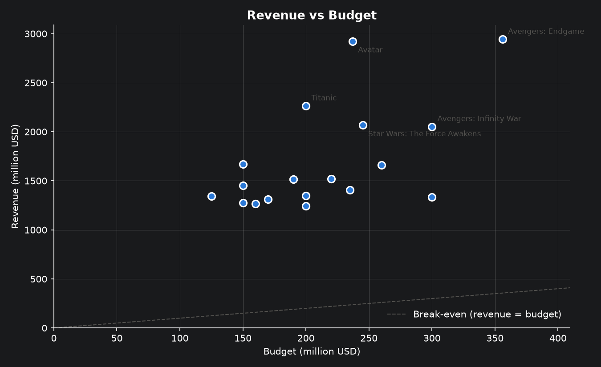

# TMDB Movie Data Analysis with Spark (PySpark)

A movie data analysis pipeline built with **PySpark**: it fetches 18 blockbuster movies from the
[TMDB API](https://developer.themoviedb.org/), cleans and restructures the nested JSON data, calculates KPIs
(revenue, profit, ROI, ratings, franchise and director performance) and visualises the results with Matplotlib.



## Tech stack (tested versions)

| Tool | Version |
|---|---|
| Python | 3.14 |
| Java (Eclipse Temurin) | 25 (PySpark 4.x needs Java 17 or newer) |
| PySpark | 4.3.0 |
| pandas | 2.3.3 (pandas 3.x is not yet fully supported by PySpark) |
| Matplotlib | 3.11.2 |
| Other packages | pinned in `requirements.txt` |
| OS / IDE | Windows 11, PyCharm |

## Setup (Windows)

1. **Install Java 17+** (e.g. Eclipse Temurin) and make sure `JAVA_HOME` is set.
2. **Hadoop helpers for Windows:** copy `winutils.exe` and `hadoop.dll` (from `cdarlint/winutils`, folder
   `hadoop-3.3.6/bin`) into `C:\hadoop\bin`, set `HADOOP_HOME=C:\hadoop` and add `C:\hadoop\bin` to `PATH`.
   Without them Spark cannot write files on Windows.
3. **Use a project path without spaces or `&`.** Spark's Windows launch scripts break on paths such as
   `LABS & Docs`; this project lives in `C:\Users\User\Desktop\LABS_Docs\tmdb-spark-analysis`.
4. **Create a virtual environment and install the pinned packages** (from the project root):
   ```powershell
   python -m venv .venv
   .\.venv\Scripts\Activate.ps1
   pip install -r requirements.txt
   ```
5. **Add your TMDB API key:** create a file named `.env` in the project root containing
   ```text
   TMDB_API_KEY=your_tmdb_api_key_here
   ```
   `.env` is ignored by Git and must never be committed.
6. **Optional check:** run `notebooks/00_environment_check.ipynb` to confirm Python, Java, Spark, a UDF,
   Parquet writing and the API key all work.

## How to run

**Option 1: notebook (recommended).** Open `notebooks/tmdb_spark_analysis.ipynb` and run all cells.
Section 1 runs the data pipeline; set `FETCH_FROM_API = True` to download fresh data from TMDB.

**Option 2: data pipeline only (terminal, from the project root).**
```powershell
python -m src.pipeline           # reuse saved raw data in data/raw/
python -m src.pipeline --fetch   # call the TMDB API first
```

Output: `data/raw/movies.json` (raw API responses) and `data/processed/movies_clean.parquet` (cleaned data).
Both are recreated by the code and are therefore not committed.

## Project structure

```text
tmdb-spark-analysis/
├── README.md
├── requirements.txt              pinned package versions
├── .gitignore                    excludes data/, .env, .venv/, .idea/, caches
├── notebooks/
│   ├── 00_environment_check.ipynb    setup check (Spark, UDF, Parquet, API key)
│   └── tmdb_spark_analysis.ipynb     analysis, visualisations, conclusions
├── src/
│   ├── config.py      settings: paths, API, movie IDs, column lists, thresholds
│   ├── fetch.py       TMDB API calls (retries, timeout, logging) and raw JSON saving
│   ├── cleaning.py    cleaning steps, value counts, Parquet save/load
│   ├── kpis.py        profit/ROI, ranking helper + UDF, searches, franchise and director KPIs
│   ├── plots.py       the five Matplotlib charts
│   └── pipeline.py    Spark session + fetch → clean → save, in one call
├── reports/
│   ├── REPORT.md      final report: method, insights, limitations
│   └── figures/       saved charts (PNG)
└── data/              raw and processed data (ignored, recreated by the pipeline)
```

## Pipeline

1. **Fetch:** 19 IDs requested with `append_to_response=credits`; ID `0` does not exist and is logged and skipped
   (18 movies). Temporary errors are retried with exponential backoff; a rejected API key stops the run
   immediately; the key is never written to the logs.
2. **Clean** (`src/cleaning.py`, run in order by `src/pipeline.py`): drop irrelevant columns · flatten JSON-like
   columns with `"|"` · extract cast, director, cast size and crew size · convert types with `try_cast` /
   `try_to_date` · 0 budget/revenue/runtime → NULL · convert to million USD · zero-vote ratings and placeholder
   text → NULL · remove rows without id/title, duplicates and rows with < 10 values · keep "Released" movies ·
   select the 22 required columns in order · save a Parquet checkpoint.
3. **Analyse** (`src/kpis.py`): 10 best/worst rankings, two search queries, franchise vs standalone,
   top franchises and top directors.
4. **Visualise** (`src/plots.py`): five charts, shown in the notebook and saved to `reports/figures/`.

## Design choices

| Choice | Reason |
|---|---|
| Logic in `src/`, notebook for results | Reusable, testable functions; a readable notebook with executed outputs |
| Settings in `config.py` | One place for IDs, paths, column lists and thresholds |
| Profit and ROI calculated once (`kpis.add_financial_metrics`) | No formula is duplicated across rankings, comparisons and charts |
| Built-in Spark functions for cleaning | Run inside Spark (fast); Python UDFs only where needed |
| Window `rank()` for rankings + a Spark UDF for formatting | A row-by-row UDF cannot compare rows; the UDF runs only on the top-N rows |
| `try_cast`, `try_to_date`, `try_divide` | Spark 4 runs in ANSI mode, where `cast`, `to_date` and `/` fail on bad values; the `try_` versions return NULL |
| Empty lists and placeholders → NULL, not `""` | Missing data stays visible and the "≥ 10 non-null values" rule stays honest |
| Exact name matching in searches (`has_item`) | `"Russo"` must not match `"Joe Russo"` |
| Parquet checkpoint | Keeps the cleaned schema (CSV would turn dates and numbers into text) |
| Small charts via `.toPandas()` | Spark aggregates first; only small results reach Matplotlib |
| No dual-axis charts | Different units get separate panels, which are easier to read correctly |

## Key results

- **Avatar** has the highest revenue (~$2.92B); all 18 films earned far more than their budgets.
- **The Avengers Collection** is the most successful franchise in total revenue; **James Cameron** is the
  most successful director (~$5.19B from 2 films).
- The two required searches (Bruce Willis; Uma Thurman + Quentin Tarantino) return **no movies**, because none
  are in this dataset. The search logic is validated on people who are in it.

Full findings, charts and limitations: [`reports/REPORT.md`](reports/REPORT.md).

## Deliverables

| Deliverable | Where |
|---|---|
| Complete workflow | `notebooks/tmdb_spark_analysis.ipynb` (run with outputs) + `src/` |
| Final report | `reports/REPORT.md` |
| Efficient code | Modular functions in `src/`, settings in `src/config.py`, pinned `requirements.txt` |
| Git best practices | One commit per step/phase, `.gitignore` for data, secrets and IDE files |

