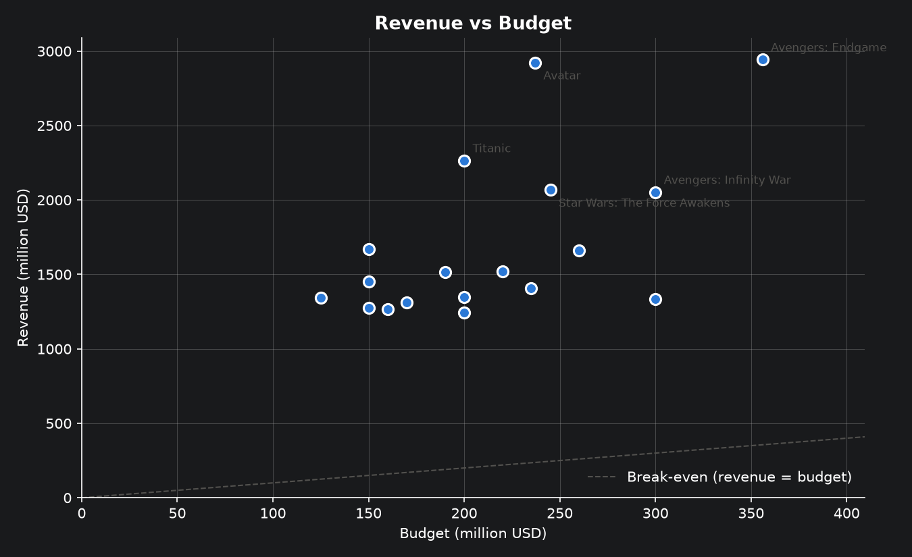
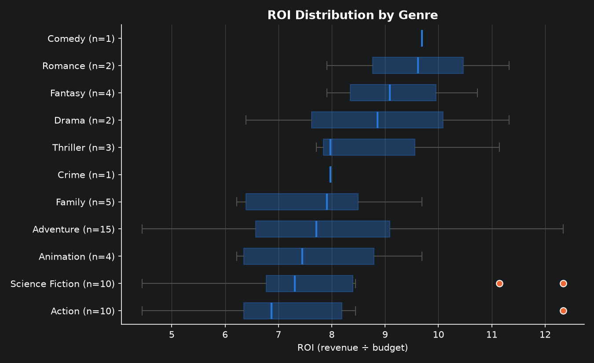
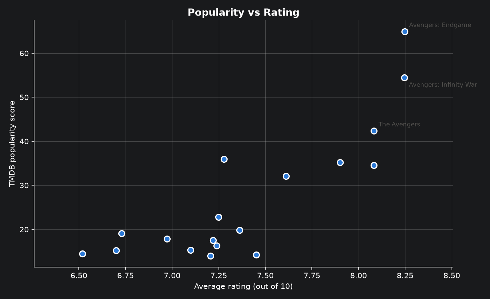
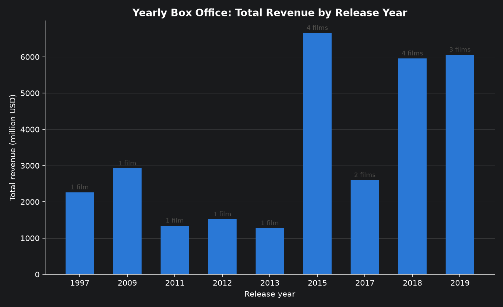
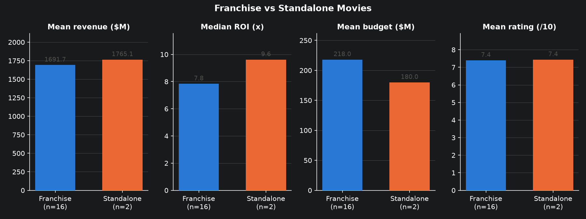

# TMDB Movie Data Analysis with Spark: Final Report

**Author:** David Kamanda · **Data:** TMDB API, fetched [date of your fetch] · **Tools:** PySpark 4.3.0, Matplotlib

## 1. Summary

- All **18 movies** analysed are blockbusters, and **every one earned far more than its budget**.
- **Avatar** has the highest revenue (**~$2.92B**) and one of the highest returns on investment (**~12×**).
- **The Avengers Collection** is the most successful franchise (4 films); **James Cameron** is the most successful
  director (**~$5.19B** from *Avatar* and *Titanic*).
- Bigger budgets do **not** guarantee bigger returns: revenue is only loosely related to budget.
- Both required search queries return **no movies**: the dataset contains no Bruce Willis, Uma Thurman or
  Quentin Tarantino films. The search logic itself was validated.

## 2. Data

| Item | Detail |
|---|---|
| Source | TMDB API, `/movie/{id}` with `append_to_response=credits` (adds cast and crew) |
| Requested | 19 movie IDs given in the assignment |
| Fetched | **18** (ID `0` does not exist; it was logged and skipped) |
| Raw shape | 18 movies × 28 columns, with nested JSON (genres, companies, credits, …) |
| Clean shape | 18 movies × 22 required columns (+ `profit_musd`, `roi` for analysis) |

## 3. Methodology

**Fetching.** Each movie is requested individually (the API returns one movie per request) using one shared
HTTP session, a 10-second timeout and up to 3 attempts with exponential backoff for temporary errors.
A rejected API key stops the run immediately, and the key never appears in the logs.

**Cleaning (PySpark).** Eleven steps run in order in `src/pipeline.py`:

1. Drop irrelevant columns (`adult`, `imdb_id`, `original_title`, `video`, `homepage`).
2. Flatten JSON-like columns into `"|"`-separated text (collection, genres, languages, countries, companies).
3. Extract `cast`, `cast_size`, `director` (crew with job exactly "Director") and `crew_size`.
4. Convert datatypes with `try_cast` / `try_to_date`: invalid values become NULL instead of stopping the job.
5. Treat 0 budget, revenue or runtime as unknown (NULL).
6. Convert budget and revenue to million USD.
7. Set ratings with zero votes, and placeholder text, to NULL.
8. Remove rows without id/title, duplicate ids and rows with fewer than 10 non-null values.
9. Keep only "Released" movies.
10. Select the 22 required columns in the required order.
11. Save a Parquet checkpoint (keeps the cleaned data types).

**Data quality outcome:** no duplicates, missing titles, zero values, zero-vote ratings or placeholder texts
were found, so no rows were removed. The rules remain in place for future fetches.

**Analysis.** Profit (revenue − budget) and ROI (revenue ÷ budget) are calculated once and reused everywhere.
Rankings use a window `rank()` plus a Spark UDF that formats the results; ROI rankings only include budgets of
at least $10M, and rating rankings only movies with at least 10 votes. Searches use exact name matching.

## 4. Results

### 4.1 Best and worst performers

| Ranking | Top result |
|---|---|
| Highest revenue | *Avatar* (~$2.92B), then *Avengers: Endgame* (~$2.80B) |
| Highest budget | [title] ([$…M]) |
| Highest profit | [title] ([$…B]) |
| Lowest profit | [title] ([$…B]), still hugely profitable |
| Highest ROI (budget ≥ $10M) | [title] ([x]×) |
| Lowest ROI (budget ≥ $10M) | [title] ([x]×) |
| Most voted | [title] ([n] votes) |
| Highest / lowest rated | [title] ([x]/10) / [title] ([x]/10) |
| Most popular | [title] (TMDB popularity is a daily snapshot) |

### 4.2 Revenue vs budget

All films sit far above the break-even line. Budget is only loosely related to revenue: *Avatar* (~$237M budget)
earned more than twice as much as *Avengers: Age of Ultron* (~$365M).

### 4.3 ROI by genre

[Genre] has the highest median ROI ([x]×) but only [n] films. Adventure (15 films) and Action / Science Fiction
(10 each) are the most reliable comparisons. Genres with 1–2 films should not be over-interpreted.

### 4.4 Popularity vs rating

[Higher-rated films tend to be / are not clearly] more popular. [Title] is currently the most popular film.

### 4.5 Yearly box office

2015 has the highest total revenue, with 4 films. Yearly totals mainly reflect how many of these 18 films were
released each year, so they describe this sample rather than the whole film market.

### 4.6 Franchise vs standalone

| | Franchise (16) | Standalone (2) |
|---|---|---|
| Mean revenue | [$…M] | ~$1,765M |
| Median ROI | [x]× | ~9.6× |
| Mean budget | [$…M] | ~$180M |
| Mean rating | [x] | [x] |

Franchise films cost more on average; the two standalone films had a higher median ROI, driven by *Titanic*.
With only two standalone films, this comparison is indicative, not conclusive.

### 4.7 Most successful franchises and directors

- **Franchises:** *The Avengers Collection* leads on total revenue ([$…B] from 4 films); *Avatar Collection*
  earns the most per film (one film).
- **Directors:** James Cameron (~$5.19B, 2 films), then Anthony and Joe Russo (~$4.85B each, credited for
  *Endgame* and *Infinity War*). Co-directed films count for each director, so totals overlap.

### 4.8 Search queries

| Query | Result |
|---|---|
| Best-rated Science Fiction Action movies starring Bruce Willis | 0 movies |
| Movies starring Uma Thurman directed by Quentin Tarantino | 0 movies |

Both are correct for this dataset: the full cast lists contain neither actor, and no film is directed by Tarantino.
The same search function returned the expected films for people in the data (Chris Evans; Joe Russo).

## 5. Limitations

- **Small, biased sample:** 18 hand-picked blockbusters, not a representative set of films.
- **Only 2 standalone films**, so the franchise comparison is not statistically reliable.
- **No inflation adjustment:** *Titanic* (1997) is compared directly with 2019 releases.
- **Popularity changes daily** on TMDB, so popularity results are a snapshot.
- **TMDB figures** (budget, revenue) are community-maintained and may differ from official studio numbers.

## 6. Conclusions and next steps

The PySpark pipeline turns nested API data into a clean, typed dataset and supports reusable KPI analysis.
For these blockbusters, success is driven more by the film or franchise itself than by budget size.

**Next steps:** analyse a larger, more varied sample (e.g. via TMDB's discover endpoint), adjust revenue for
inflation, and add statistical tests before drawing general conclusions.